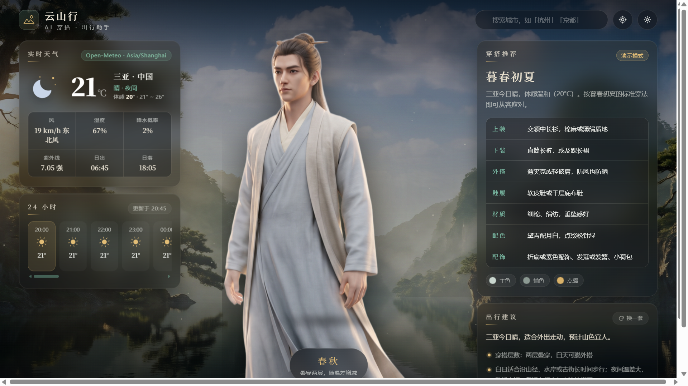
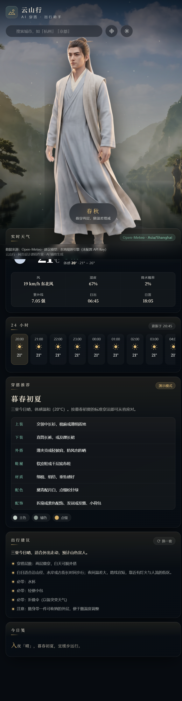

# 云山行 · AI 穿搭与出行助手

> 网页设计课程作业 · AI 辅助生成
> 一个把 **实时天气** 翻译成 **穿搭方案** 和 **出行建议** 的单页网站。
> 视觉基调取自中式青绿山水 + 水墨写意，3D 写实渲染；立绘随体感温度自动更换。

### 在线演示

**https://mulii0124.github.io/PracticeTask_qian_yunshan/**

> 直接打开即可使用：天气走 Open-Meteo 免密钥接口，AI 建议在未配置 Key 时自动由本地规则引擎生成，页面功能完整不白屏。
> 想体验真实大模型生成，在页面右上角 **「AI 设置」** 里填入自己的 API Key 即可（Key 只存在自己浏览器的 localStorage，不进仓库）。



<details>
<summary>移动端（响应式）截图</summary>



</details>

### 素材总览


---

## 一、项目定位

大多数天气网站只告诉你"今天 18 度，多云"。但真正的问题是：**18 度该穿什么？带不带伞？**。

云山行把这两个问题接在一起：左边是气象事实，中间是一个穿好衣服的人，右边是可执行的建议。

- **天气是输入，不是背景板** —— 体感温度决定立绘换哪一身，天气类型决定背景切哪张山野，降水概率决定要不要带伞。
- **AI 真正参与决策** —— 穿搭与出行文案由大模型基于实时气象数据生成，不是写死的模板。
- **没有 API Key 也能跑** —— 未配置模型时自动降级为本地规则引擎，页面功能完整，答辩现场断网也不慌。

## 二、功能一览

| 模块 | 说明 |
|---|---|
| 实时天气 | 温度 / 体感 / 最高最低温、天气状态、风力风向、湿度、降水概率、紫外线强度、日出日落 |
| 24 小时预报 | 横向滚动的小时级预报，带天气动效图标与降水概率 |
| 3D 场景层 | 4 张山野背景按天气类型交叉淡入切换；3 层视差云雾；Canvas 粒子（雨 / 雪 / 雾 / 浮尘） |
| 昼夜与天气色调 | 夜间自动叠加深蓝调，黄昏叠加暖橙调，雨雪叠加冷色调 |
| 人物立绘 | 5 套穿搭立绘，按体感温度与天气自动切换，带呼吸浮动动画与接地阴影 |
| 穿搭推荐 | 上装 / 下装 / 外搭 / 鞋履 / 配饰 / 材质 / 配色 + 可视化色板 |
| 出行建议 | 穿搭层数、必带物品、时段路线建议、注意事项 |
| 今日笺 | 一句不超过 30 字的当日提示 |
| 城市搜索 | 接入 Open-Meteo 地理编码，支持中英文城市名 |
| 定位 | 浏览器 Geolocation + OpenStreetMap 反查地名 |
| 换一套 | 重新生成一套配色与配饰方向不同的方案 |
| AI 配置面板 | 在页面内填 Base URL / 模型 / API Key，自带连通性测试；**Key 类型预设**（M Plan 订阅 / 按量计费）一键切换域名与模型；可拉取账号可用模型列表；面板内可直接查看完整系统提示词 |
| 超链接 | 页脚 4 条外链（天气数据源 / 模型平台 / 作业说明 / 源码仓库）+ 天气面板可点击的数据来源标签 + 配置面板内的官方文档链接 |
| 降级机制 | 模型调用失败自动回落到本地规则引擎，并在状态栏注明原因 |

## 三、技术栈

- **纯静态**：HTML + CSS + 原生 JavaScript，零依赖、零构建、零后端
- **天气数据**：Open-Meteo Forecast & Geocoding API（**免注册、免密钥**）
- **可选 AI**：任意 OpenAI 兼容的 `chat/completions` 接口（MiniMax / DeepSeek / Moonshot / 智谱 / 通义 / SiliconFlow / Ollama 均可）
- **动效**：CSS 3D transform + Canvas 2D 粒子系统，全站尊重 `prefers-reduced-motion`

## 四、文件结构

```
ai-outfit-assistant/
├── index.html              # 页面结构
├── css/
│   └── style.css           # 视觉系统：3D 场景、玻璃面板、天气动效、响应式
├── js/
│   ├── config.js           # 天气字典、穿搭分级、AI 提示词、本地降级规则引擎
│   ├── weather.js          # Open-Meteo 天气 / 城市搜索 / 地名反查
│   ├── ai.js               # 大模型调用层（JSON 容错解析 + 自动降级）
│   └── app.js              # 页面主逻辑：数据流、渲染、粒子系统、交互
├── assets/img/
│   ├── scenes/             # 4 张 3D 山野背景（AI 生成）
│   └── characters/         # 5 张穿搭立绘（AI 生成 + 抠图，透明背景）
├── gen/
│   ├── requests.json       # 图像生成提示词全文（可复现）
│   ├── manifest.json       # 素材节点 ID 与说明
│   ├── finalize.py         # 抠图后裁边 / 缩放 / 压缩
│   ├── preview.py          # 生成素材总览图
│   ├── desktop-check.html  # 开发辅助：在窄屏面板里校验 1440px 桌面布局
│   ├── cors-check.html     # 开发辅助：实测各模型接口的浏览器跨域可用性
│   └── preview-assets.png  # 素材总览
├── screenshot-desktop.png  # 成品截图（桌面端）
└── screenshot-mobile.png   # 成品截图（移动端）
```

## 五、本地运行

直接双击 `index.html` 大概率能用，但**推荐用本地服务器**，否则浏览器可能拦截定位与跨域请求：

```bash
cd ai-outfit-assistant
python -m http.server 8123
# 然后打开 http://127.0.0.1:8123
```

部署到任何静态托管（GitHub Pages / Vercel / Netlify / 校园服务器）均可，纯静态无需服务端。

### 已上线：GitHub Pages

本项目已通过 **GitHub Pages** 发布，仓库为 Public：

- 线上地址：**https://mulii0124.github.io/PracticeTask_qian_yunshan/**
- 发布方式：分支发布（`main` 分支 / `/root` 目录），仓库根目录含 `.nojekyll` 文件，让 Pages 原样吐出静态文件而不走 Jekyll 模板解析
- 页面内所有资源一律使用**相对路径**，因此部署到 `github.io/<仓库名>/` 子路径下不会丢图丢样式

后续更新只需本地改完 `git push`，GitHub 会自动重新构建发布，无需手动再点设置。

## 六、接入大模型

### 6.1 三个字段填什么

点右上角 **「AI 设置」**（金色齿轮）打开「AI 配置」面板。面板最上方是 **「Key 类型预设」** 两张卡片，选一张会自动填好 Base URL 和模型：

| 预设卡片 | 接口地址 Base URL | 模型 Model | 适用 |
|---|---|---|---|
| **M Plan 订阅 Key** | `https://api.minimax.cn/v1` | `MiniMax-M3.1-Flash` | MiniMax 官方 **M Plan 套餐** 订阅用户 |
| **按量计费 API Key** | `https://api.minimaxi.com/v1` | `MiniMax-M2.7` | 在开放平台按调用量付费充值 |

三个字段的含义：

| 字段 | 填什么 | 说明 |
|---|---|---|
| 接口地址 Base URL | 上面预设自动填好 | **不要带 `/chat/completions`**，程序会自动拼接 |
| 模型 Model | 上面预设自动填好 | 拿不准就用下面的「拉取模型列表」按钮自动获取 |
| API Key | `sk-...` 一长串 | 只存在你自己浏览器的 localStorage，不进仓库 |

填完点 **保存并测试**，显示「连接正常」即接入成功；页面右上角标签会从「演示模式」变成「AI · 模型名」，底栏也会标出当前模型。

> 不配置也能用：此时由 `js/config.js` 的本地规则引擎生成建议，底栏标注「本地规则引擎（未配置 API Key）」。

### 6.2 怎么拿到 Key

#### 方式 A：M Plan 订阅 Key（如果你买了 M Plan 套餐）

1. 打开 **https://platform.minimax.cn/console/plan** 进入 **M Plan 套餐** 页面
2. 选择 Go / Explore / Build 档位并开通，**订阅 Key 的特征是 `sk-cp-` 前缀**
3. 复制订阅 Key（同样是**只完整显示一次**，关闭弹窗后无法再查看）
4. 在页面里选 **「M Plan 订阅 Key」** 预设 → 粘贴 Key → 保存并测试

M Plan 使用注意（依据官方 FAQ）：

- **订阅 Key 与按量计费 API Key 是两套独立的凭据，不能混用**：把订阅 Key 填到 `api.minimaxi.com`、或把按量计费 Key 填到 `api.minimax.cn`，都会失败。
- 订阅 Key 调用已有按量计费端点时，扣的是 **M Plan 套餐额度**，**不会自动扣账户余额**。
- 文本模型为 **MiniMax-M3.1-Flash**；Explore 及以上档位额外支持 H3 视频模型。
- 受 **5 小时窗口 + 周窗口**双重限额，以及 RPM / TPM 限流；额度窗口内高频调用可能被限流，页面会自动降级到本地引擎，不会崩。
- 官方定位是「个人开发者交互式使用」，**生产环境建议按量付费**——本作业是课堂演示，完全够用。

#### 方式 B：按量计费 API Key（推荐给不想买套餐的人）

1. 打开 **https://platform.minimaxi.com/login** 注册 / 登录（手机号验证码）
2. **完成实名认证** —— 未认证会限制创建密钥和充值
3. **充值** —— 余额为 0 时即使密钥正确也会报 `1008 insufficient balance`
4. 左侧菜单 **「账户管理 → 接口密钥」→ 创建新的密钥**，填个备注名（如 `yunshan-web`）→ 创建
5. 密钥**只完整显示一次**，弹窗关闭后无法再查看，立刻复制保存

拿到 Key 后粘贴进输入框，点 **「拉取模型列表」** 会自动列出你账号实际可用的模型（按 `MiniMax-M3.1-Flash` → 含 `flash` → `MiniMax-M3` 系列 → 其余 `MiniMax-M*` 的优先级自动挑选），选一个即可。

### 6.3 几个最容易踩的坑

| 现象 | 原因 | 解决 |
|---|---|---|
| 401 `login fail` | Key 复制不全 / 用了别的平台的 Key | 重新复制；确认平台与域名一致 |
| 401 | 国内 Key 配了海外域名（或反之） | 国内用 `api.minimaxi.com` / `api.minimax.cn`，海外用 `api.minimax.io`，**不可混用** |
| 401 | **M Plan 订阅 Key 配到了按量计费域名** | 订阅 Key 用 `api.minimax.cn`，按量计费 Key 用 `api.minimaxi.com`，**两者互不通用** |
| 1008 余额不足 | 没充值 / 额度用完 | 回平台充值（用 M Plan 订阅 Key 则检查套餐额度窗口） |
| 404 | Base URL 里手写了 `/v1/chat/completions` | 只填到 `/v1` 为止 |
| 模型名报错 | 模型 ID 写错或该账号无权限 | 点「拉取模型列表」自动获取 |
| 返回内容为空 | 模型默认开启思考过程，token 预算被思考吃掉 | 程序已把 `max_tokens` 提到 3000，并兜底解析 `reasoning_content`，一般无需手动处理 |

### 6.4 换其他服务商

只要服务商提供 **OpenAI 兼容的 `POST {base}/chat/completions`**（DeepSeek、Kimi / 月之暗面、智谱 GLM、通义千问、SiliconFlow、Ollama 本地等）都可以，替换 Base URL / 模型 / Key 三个值即可。

### 6.5 关于「把 Key 放在浏览器里」

本项目把 Key 存在**使用者本机**的 localStorage，代码里是空的，仓库里没有任何密钥——公开的 GitHub Pages 因此是安全的。

但仍请注意：**不要**把 Key 硬编码进 `js/ai.js` 再提交，那样全网都能看到你的 Key。MiniMax 官方也明确建议不要在浏览器端代码中放置服务端凭据。本项目之所以可行，是因为 Key 由每个访问者在自己浏览器里自行填写；**演示给别人看时，请让对方自己填自己的 Key**。

### 6.6 跨域可用性（已实测）

本项目从浏览器直连模型接口，因此接口必须允许跨域。已用 `gen/cors-check.html` 在真实浏览器中实测：

| 域名 | `GET /v1/models` | `POST /v1/chat/completions` |
|---|---|---|
| `api.minimaxi.com`（按量计费） | HTTP 401 → 跨域通过 | HTTP 401 → 跨域通过 |
| `api.minimax.cn`（M Plan 订阅） | HTTP 401 → 跨域通过 | HTTP 401 → 跨域通过 |
| `api.minimax.io`（海外） | HTTP 401 → 跨域通过 | HTTP 401 → 跨域通过 |
| `api.minimax.chat`（旧域名） | HTTP 401 → 跨域通过 | HTTP 401 → 跨域通过 |

401 表示"网络可达、跨域放行，只是密钥无效"，说明浏览器直连这条路是通的。若将来换用其他服务商报跨域错误，页面会自动降级到本地规则引擎，不会白屏。

### 6.7 M3 系列模型的三个特殊参数（真机联调踩坑记录）

用 M Plan 订阅 Key 联调时，模型**始终不返回正文**，页面每次都悄悄降级。查官方 API 文档后发现是三个参数导致的：

| 参数 | 官方规定 | 本项目的处理 |
|---|---|---|
| `max_tokens` | **已弃用**，官方要求改用 `max_completion_tokens` | MiniMax 域名下改发 `max_completion_tokens: 16000`；其他服务商仍发 `max_tokens: 3000` |
| `reasoning_effort` | 可取 `low/medium/high/xhigh/max`，**默认 `max`**；只有 M3.1-Flash 真正生效，其他模型忽略该字段 | 显式传 `'low'`，思考链从 3000 token 降到 41 token |
| `thinking` | M3.1-Flash **强制开启**，传 `disabled` 直接 HTTP 400 | 不传该参数 |
| `temperature` | **传了不生效**，M3.1-Flash 固定用 1 | 仍保留面板上的滑杆（其他服务商有效），并在此说明 |

联调前后对照（同一份系统提示词 + 同一份天气数据）：

| 指标 | 修复前 | 修复后 |
|---|---|---|
| `source` | `fallback`（静默降级） | **`ai`** |
| `reasoning_tokens` | 3000（预算吃光） | **41** |
| `completion_tokens` | 3000（被截断） | **784** |
| `finish_reason` | `length` | **`stop`** |
| 正文 `content` | 不存在 | **1231 字符，JSON 解析成功** |
| 单次耗时 | 35.8 s | **26.1 s** |

> 这次联调也印证了本项目的降级机制是**真的在兜底**：模型失败时页面不会白屏，而是切回本地规则引擎，状态栏如实写出失败原因 —— 但也正因为"看起来还挺正常"，这个 bug 才不容易被一眼发现。

## 七、AI 使用说明

> 这一节对应作业评分表里常见的"AI 使用说明"项，如实记录本项目中 AI 参与的全部环节。

### 7.1 图像生成（9 张）

使用 **MiniMax 图像生成**能力，提示词全文保存在 `gen/requests.json`，可完整复现。

**场景图（4 张，16:9 / 2K）** — 提示词结构：

```
Cinematic 3D render of a vast Chinese landscape, realistic ancient China,
fused with traditional green-and-blue landscape painting (qinglue shanshui)
and ink-wash aesthetics. <天气与光线条件描述>. Atmospheric perspective,
drifting mist, soft volumetric light, photorealistic PBR materials,
ultra detailed, wide establishing shot, no people, no text, no watermark
```

**人物立绘（5 张，3:4 / 2K）** — 提示词结构：

```
Cinematic 3D game character render, full body standing, three-quarter view,
realistic ancient Chinese clothing. <具体服装描述>. Anatomically correct adult
proportions, detailed fabric folds and cloth physics, soft rim lighting,
semi-realistic realistic rendering, character concept art, centered composition,
isolated on a solid pure white background, no scenery, no ground shadow, no text
```

**关键设计决策**：所有立绘统一使用"纯白背景 + 同一机位 + 同一光照"，这样抠图后可以无缝替换，视觉上像同一个人的不同穿搭，而不是五张拼贴。

**后处理**：AI 抠图工具去除背景 → `gen/finalize.py`（Pillow）裁掉透明边、等比缩放到 1200px 高、压缩体积。

### 7.2 代码生成

使用 AI 编程助手生成本项目的 HTML / CSS / JS 初版，随后**逐文件人工审查并修正**了以下实际缺陷（这些是初版真实存在的问题，也是本项目区别于"直接抄 AI 输出"的关键）：

| # | 问题 | 修正 |
|---|---|---|
| 1 | 场景图交叉淡入时，若目标图与当前活动图 `src` 相同会提前 `return`，导致切换城市后背景停留在上一城市 | 改为比较"当前活动图"与目标 src，并处理缓存命中情况 |
| 2 | 本地规则引擎多个温度分支的文案带 `体感` 前缀，与模板拼接后出现"体感体感寒冷" | 统一去掉分支内的前缀 |
| 3 | 建议摘要拼接时句号重复（`…不易干爽。。`） | 改为按分句截取并清理尾部标点 |
| 4 | 立绘超出中列容器，把穿搭分级徽章挤出视口 | 中列改为视口高度约束 + 立绘 `flex` 自适应 |
| 5 | "换一套"在本地降级模式下输出完全不变 | 本地引擎加入配饰 / 配色 / 点句的轮换表 |
| 6 | 立绘由 JPG 换成透明 PNG 后，代码中路径未同步 | 同步更新 `config.js` 与 `index.html` |
| 7 | 「定位」的反查地名请求（Nominatim）没有超时，在该接口不可达的网络下 `await` 永远挂起，导致点了定位按钮天气不刷新、像失灵一样 | 给 `reverseName()` 加 `AbortController` 6 秒超时，超时自动回退为「当前位置」并继续加载天气 |
| 8 | **接 M Plan 真机联调时发现**：MiniMax-M3.1-Flash 强制开启深度思考，`max_tokens: 3000` 全被思考链吃掉（`reasoning_tokens=3000`），正文 `content` 字段根本不存在，`finish_reason=length` —— JSON 解析必然失败，每一次调用都静默降级到本地引擎 | 改用官方新参数 `max_completion_tokens`（`max_tokens` 已弃用）+ 显式 `reasoning_effort: 'low'`（官方默认是 `max`）；实测思考链降到 41 token、正文 1231 字符完整返回，`source` 从 `fallback` 变为 `ai` |

另外还补充了初版没有的能力：昼夜色调切换、天气粒子系统、24 小时预报条、配置面板的连通性测试与提示词预览、页面超链接，以及 AI 生成期间的「推演中」等待反馈与启动屏提前收起（原本要等模型返回才显示页面）。

### 7.3 运行时大模型调用（核心功能）

这是 AI **真正参与功能逻辑**的部分，而非装饰。

**系统提示词**（完整版可在页面的「AI 配置 → 查看系统提示词」中直接看到）：

```
你是一位精通中式东方美学的穿搭顾问兼出行策划师，同时具备严谨的天气数据解读能力。
风格要求：语言凝练雅致，可以适度使用中式意象（月白、青竹、鸦青、松针、绛紫等）来描述服装与配色，
但每一条都必须落到可执行的具体信息：材质、厚度、颜色、款式、随身物品。禁止只有意象没有实操。

严格只输出一个 JSON 对象，不要输出任何解释文字，不要用 Markdown 代码块包裹，不要输出 JSON 以外的字符。
（后接完整 JSON 结构定义）
```

**用户提示词**由实时天气动态拼装：地点、时间、天气状态、当前温度 / 体感 / 最高最低温、风力风向、阵风、湿度、降水量与概率、云量、紫外线、日出日落。

**输出结构**：模型必须返回固定 JSON（`outfit` / `travel` / `daily_note` 三段），前端据此渲染。工程上的三点处理：

1. **容错解析**：容忍模型输出的 ```` ```json ```` 包裹、前后废话、尾随逗号（`js/ai.js` 的 `parseLoose`）；
2. **字段补全**：模型漏字段时用本地规则引擎的结果兜底，绝不出现空白卡片；
3. **故障降级**：接口超时 / 报错 / 返回非 JSON，自动切回本地引擎，并在状态栏写明失败原因与错误信息。

**交互闭环**：点「换一套」会追加一条额外指令（"更换配色与材质方向，但同样要贴合今日气温与天气"），让模型给出不同方案，而不是简单重试。

**真机联调**：本项目的 AI 链路已用 MiniMax **M Plan 订阅 Key** 在真实浏览器中跑通（`api.minimax.cn` + `MiniMax-M3.1-Flash`），状态栏会显示 `建议模型：MiniMax-M3.1-Flash`，穿搭推荐 / 出行建议 / 今日笺三张卡全部由模型实时生成。联调过程发现并修复了深度思考模型的一个关键参数问题（详见 6.7 与第七节的缺陷修正表第 8 条）。模型输出偶有中英混杂的小瑕疵，属模型自身表现，页面已做字段级兜底，不会出现空白卡片。

## 八、数据来源

| 数据 | 来源 | 协议 |
|---|---|---|
| 实时天气 / 小时预报 / 紫外线 | [Open-Meteo](https://open-meteo.com/) Forecast API | CC BY 4.0，免密钥 |
| 城市检索 | Open-Meteo Geocoding API | 同上 |
| 地名反查 | [OpenStreetMap Nominatim](https://nominatim.openstreetmap.org/) | ODbL |
| 全部美术资源 | AI 生成（MiniMax 图像生成） | 本项目自用 |

### 页面中的超链接

页面共使用 6 处超链接，全部为 `target="_blank" rel="noopener noreferrer"` 的外链：

| 位置 | 链接文字 | 指向 | 作用 |
|---|---|---|---|
| 页脚 | Open-Meteo 天气 | <https://open-meteo.com/> | 天气数据来源署名 |
| 页脚 | MiniMax 开放平台 | <https://platform.minimax.cn/docs> | AI 模型服务商与接入文档 |
| 页脚 | 作业说明 README | 仓库 README 页面 | 在线查看本说明（含 AI 使用说明） |
| 页脚 | 源码仓库 | GitHub 仓库首页 | 查看全部源码 |
| 天气面板 | Open-Meteo · 时区 | <https://open-meteo.com/> | 可点击的数据来源标签 |
| AI 配置面板 | 官方文档 ↗ | <https://platform.minimax.cn/docs/llms.txt> | Base URL 与取 Key 方式的官方说明 |

> 所有链接目标均已用 HTTP HEAD 实测可达（200），并逐个在浏览器中确认可正常打开新标签页。

## 九、已知限制

- **定位功能需要安全上下文**：`file://` 直接打开时浏览器会禁用 Geolocation，请用本地服务器或部署到 HTTPS。
- **AI 建议受模型输出质量影响**：不同模型对"中文 + 严格 JSON"的遵循度不同；程序已做容错，但极端情况可能退回本地引擎。
- **立绘是预生成的 5 张**，不是实时 3D 模型；极端气温（如 35°C 或 -15°C）会取最接近的一档。
- **Nominatim 有速率限制**（约 1 次/秒），仅用于定位后的地名反查，不影响主流程。

## 十、美术风格说明

整体视觉取向为**写实中式山水**：青绿设色的层叠远山、大气透视、水墨云雾、写实 PBR 材质与柔和体积光，交互参考了当代国产开放世界武侠游戏的美术方向。**所有图像均由 AI 生成**，不含任何第三方游戏截图、角色或素材，仅在"色调与氛围"层面向中式写实武侠审美致意。

字体使用 Google Fonts 的 Noto Serif SC（思源宋体），已配置系统衬线字体作为回退，离线时仍可正常显示。
